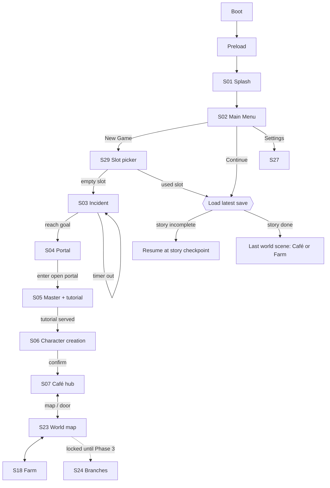

# Gameplay Flow, Scene Transitions & Shared Save State

> **Project:** TheCoffeeSixSense · **Status:** Draft v0.1 (2026-10-26) · **Branch:** `dev`
> **Related:** [GAME_DESIGN](GAME_DESIGN.md) · [SCREEN_SPECS](SCREEN_SPECS.md) · [TECHNICAL_ARCHITECTURE](../architecture/TECHNICAL_ARCHITECTURE.md)

---

## 1. Scene graph

Phaser scenes are of two kinds: **world scenes** (one active at a time) and **overlay scenes** (UI that runs on top of a world scene).



### World scenes
| Scene key | Screens | Notes |
|---|---|---|
| `StoryIncidentScene` | S03 | checkpoint save on enter |
| `StoryPortalScene` | S04 | checkpoint save on enter |
| `StoryMasterScene` | S05 | checkpoint save on enter and after tutorial |
| `CharacterCreateScene` | S06 | saves appearance + name |
| `CafeScene` | S07–S11, S13 (decorate is a mode, not a scene) | |
| `FarmScene` | S18, S20, S21 | |
| `WorldMapScene` | S23 | |
| `BranchesScene` | S24 | Phase 3 |

### Overlay scenes (launched in parallel, `scene.launch`)
| Scene key | Screens | Pauses world sim? |
|---|---|---|
| `HudScene` | HUD of S07/S18, order rail, quest tracker, joystick (S03/S04) | No |
| `PanelScene` | S12, S14, S15, S16, S17, S19, S22, S25, S26 (one panel at a time, routed by ID) | Café: soft-pause customer patience while a full panel is open `[PROPOSAL]`. Panel-over-world (S12/S19/S22): no |
| `PauseScene` | S28 | Yes (café shift); world clock keeps running (GAME_DESIGN D5) |
| `SettingsScene` | S27 | Yes |
| `SaveSlotsScene` | S29 | Yes |
| `DialogScene` | S05 dialog, quest dialog | Yes during story |

## 2. Transition rules
1. **Every world-scene change goes through one `SceneRouter.goTo(key, params)`.** Scenes never call `scene.start` directly.
2. The router: (a) asks the current scene to `serialize()` its runtime state into `GameState`, (b) **autosaves**, (c) plays the transition (fade/iris, 300–500 ms), (d) starts the next scene, which builds itself only from `GameState` + `params`.
3. A scene must be fully reconstructable from `GameState`. Transient things (customers mid-walk, an in-progress shot) are **not** saved; leaving the café ends the shift early. Seated customers finish and leave instantly; orders in progress are refunded as ingredients.
4. Story scenes save a **checkpoint** on enter, so a reload resumes at the start of that chapter.
5. Input is locked during transitions; double-clicks during a fade are ignored.

## 3. Shared game state

One `GameState` object (plain serializable data, no Phaser objects) is owned by the `StateStore`. Both farm and café read and write the same `wallet` and `inventory`.

```ts
interface SaveGame {
  schemaVersion: number;          // starts at 1; migrations in src/state/migrations.ts
  slotId: 1 | 2 | 3;
  createdAt: string; updatedAt: string; // ISO
  playtimeSec: number;
  worldClock: { gameMinutes: number; lastRealTimestamp: number }; // offline growth (cap 2h)

  story: { chapter: 'S03'|'S04'|'S05'|'S06'|'DONE'; flags: Record<string, boolean> };
  player: {
    name: string;
    appearance: { hair: string; hairColor: string; outfit: string } | null;
    level: number; exp: number; skillPoints: number;
    location: { scene: string; tile?: { x: number; y: number } };
  };
  wallet: { coins: number };
  inventory: { stacks: Array<{ itemId: string; qty: number; quality: number }> };

  farm: {
    level: number; exp: number;
    plots: Array<{
      id: string; tile: { x: number; y: number };
      state: 'locked'|'wild'|'prepared'|'growing'|'ripe'|'overripe'|'resting';
      cropId?: string; stage?: number; stageProgress?: number;
      lastWateredAt?: number; care: number;
    }>;
    processors: Array<{ id: string; kind: 'dryingBed'|'roaster'; job?: { input: string; qty: number; startedAt: number; quality: number; rakes: number } }>;
    upgrades: Record<string, number>;
  };
  cafe: {
    furniture: Array<{ uid: string; defId: string; tile: { x: number; y: number }; rot: 0|1|2|3 }>;
    storedFurniture: Record<string, number>;
    stationLevels: Record<string, number>;
    unlockedRecipes: string[];
    reputation: { recent: number[] };   // last 50 ratings
    shiftsCompleted: number;
  };
  progression: {
    skills: Record<string, number>;
    quests: Record<string, { progress: number; claimed: boolean }>;
    achievements: Record<string, { progress: number; tier: number }>;
    stats: Record<string, number>;      // drinksServed, cherriesHarvested, ...
  };
}

interface Settings {                      // stored separately, not per slot
  musicVolume: number; sfxVolume: number;
  quality: 'low'|'medium'|'high'; showFps: boolean; locale: 'vi'|'en';
}
```

### Save triggers
| Trigger | Kind |
|---|---|
| Scene transition (router) | autosave |
| Every 60 s in a world scene | autosave (debounced, skipped during transitions) |
| `visibilitychange` → hidden, `pagehide` | autosave (best-effort) |
| Pause → "Lưu game" (S28) | manual save, shows toast |
| Story chapter enter | checkpoint |
| Purchase / sale / harvest / serve | marks dirty → picked up by the next autosave (≤ 60 s) |

### Storage
- IndexedDB database `tcss`, object stores `saves` (key = slotId) and `settings` (key = `"settings"`).
- Writes are atomic per slot (one `put` of the whole `SaveGame`; saves are small, < 200 KB).
- Each save is validated on load (schema check). A corrupt save is kept as `slotN.corrupt` and the player is told; we never silently overwrite it.
- Fallback when IndexedDB is unavailable (some private-browsing modes): in-memory + a warning, plus "Export save" (download JSON) in S29 `[PROPOSAL]`.

## 4. Cross-scene interactions (farm ↔ café)
| Event | Writes | Visible in |
|---|---|---|
| Harvest cherries | inventory += cherries(grade) ; stats | S16, S22 |
| Dry / roast completes (even while in café) | farm.processors → inventory | HUD toast in any scene |
| Serve drink | inventory −= ingredients ; wallet += pay ; player.exp += exp ; reputation | S07 HUD, S11 popup |
| Buy supplies (café supplier panel) | wallet − ; inventory + | S16 |
| Sell produce (S22) | inventory − ; wallet + | HUD |
| Buy furniture (S12) | wallet − ; cafe.storedFurniture + | S13 |
| Crops ripen while in café | farm.plots | HUD badge on the map button |

All writes go through **system services** (`EconomyService`, `InventoryService`, ...), which emit typed events on the `EventBus`. The HUD and quest/achievement trackers subscribe to these events; scenes never edit numbers directly.
